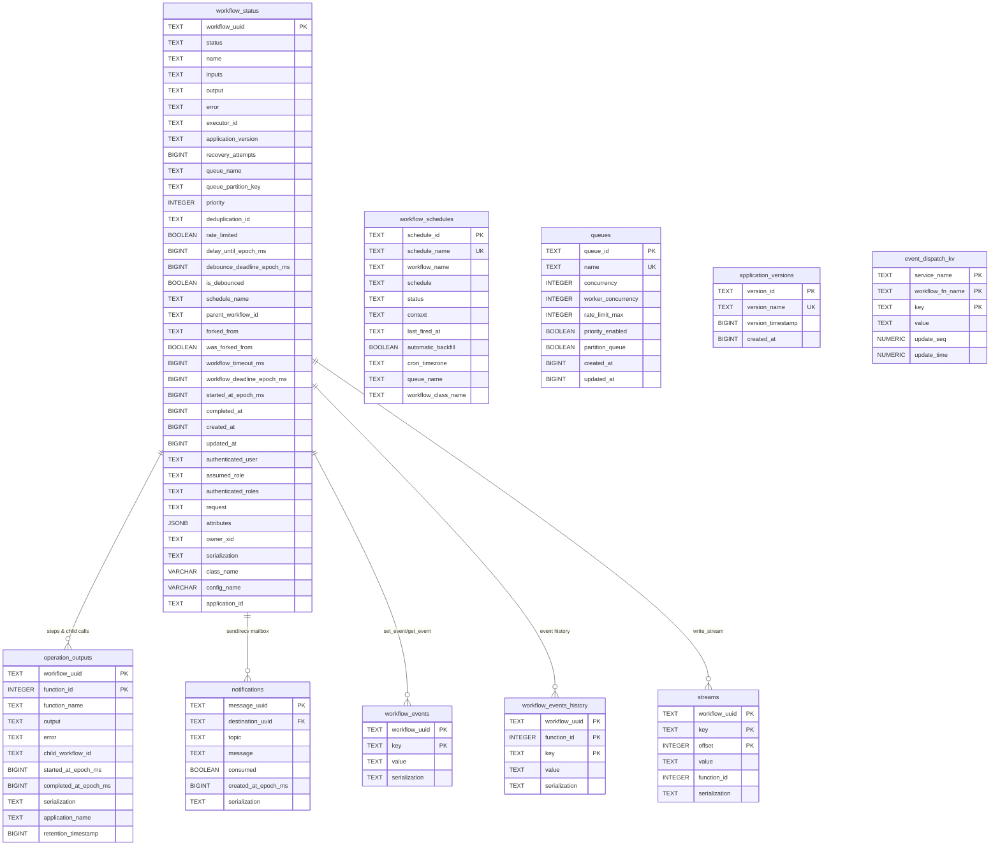

# The DBOS database schema

DBOS keeps all of its durable state in the database (Postgres, or SQLite for
local use). If a process dies partway through a workflow, everything needed to
resume it lives in these tables, so it's worth knowing how they fit together.

There are twelve tables, built up over the migrations in
[`migrations/`](../migrations), which run from 1 to 47 and then from 100 on.
Versions from 100 on are shared: every DBOS SDK defines the same migration at
the same version. The layout matches the Go and Python SDKs
column-for-column, which is what lets a workflow written by one SDK be read or
recovered by another.

The schema's version lives in `dbos_migrations`, a one-row table every DBOS SDK
reads and writes the same way. A process starting against the database reads
the row, applies the migrations newer than it, each together with its ledger
update in one transaction, and leaves a database a newer peer has already moved
ahead untouched. That is what lets processes written in different languages
share one schema. A database durare created before it kept this ledger carries
sqlx's `_sqlx_migrations` instead; the first newer durare process adopts the
newest version recorded there into `dbos_migrations` and leaves the old table
in place. Run that durare process before pointing another SDK at such a
database: a peer that finds tables but no ledger starts from migration 1 and
fails on the first table. SQLite adoption repairs the timestamp defaults
older durare databases omitted before publishing the shared version, so peer
writers can omit those columns. The repair and ledger update commit together;
legacy migration files and their checksums remain unchanged.

Most of it revolves around a single table, `workflow_status`, which has one row
per workflow run. The tables that record side effects (steps, messages, events,
streams) all point back at it and are deleted along with it. A few others
(schedules, queues, versions) stand on their own.

One convention to note up front: every timestamp is stored as milliseconds since
the epoch in a plain `BIGINT`, never a SQL `timestamp`. That keeps the on-disk
bytes identical across every language's SDK.

## How the tables relate



The last four tables in the diagram (`workflow_schedules`, `queues`,
`application_versions`, `event_dispatch_kv`) have no foreign key to
`workflow_status`, so they show up unconnected. They're registries and
bookkeeping that outlive any single run.

## workflow_status

The central table. There's one row per workflow run, written before the
workflow starts and updated as it goes, and it's the thing recovery reads to
find work that didn't finish.

It has a lot of columns because it carries everything the engine, the queues,
and the management APIs need. Grouped by what they're for:

| Group | Columns |
|---|---|
| Identity and lineage | `workflow_uuid` (primary key), `name`, `class_name`, `config_name`, `parent_workflow_id`, `forked_from`, `was_forked_from` |
| Execution state | `status`, `executor_id`, `recovery_attempts`, `owner_xid`, `application_version`, `application_id` |
| Input and output | `inputs`, `output`, `error`, `serialization` |
| Queueing | `queue_name`, `queue_partition_key`, `priority`, `deduplication_id`, `rate_limited`, `delay_until_epoch_ms` |
| Debouncing | `is_debounced`, `debounce_deadline_epoch_ms` (migration 42) — a debounced run waits `DELAYED` holding its debounce key as `deduplication_id`; each bounce pushes `delay_until_epoch_ms` out, never past the deadline, and the key is cleared when the run becomes `ENQUEUED` |
| Scheduling | `schedule_name` — the schedule that created the run (migration 41), stamped on every tick, trigger and backfill and on nothing else; a partial index serves filtering by it |
| Timing | `created_at`, `updated_at`, `started_at_epoch_ms`, `completed_at`, `workflow_timeout_ms`, `workflow_deadline_epoch_ms` |
| Auth and context | `authenticated_user`, `assumed_role`, `authenticated_roles`, `request` |
| User metadata | `attributes` — a JSON object of caller-defined key-value pairs (migration 40), searchable by containment; a partial GIN index serves those lookups on Postgres |

A run moves through a small set of states:

```
ENQUEUED → DELAYED → PENDING → SUCCESS | ERROR | CANCELLED | MAX_RECOVERY_ATTEMPTS_EXCEEDED
```

The reference SDKs have one more, `SUSPENDED`, for a run parked in the database
while its `recv` or sleep waits: `suspend_key` holds the topic and
`delay_until_epoch_ms` the time it is due, and a pass of theirs re-enqueues it
then (migrations 126 and 127). durare never parks a run. It treats a parked one
as active, and every durare send sets the wake time of a receiver parked on its
topic to zero, as the reference SDKs' sends do, so the message is not left
waiting for the receiver's timeout.

One bit of history that can trip you up: there used to be a unique constraint on
`(queue_name, deduplication_id)`, but migration 28 replaced it with a partial
index (migration 27). So deduplication now only applies to rows that are still
active, not to completed ones.

## The tables that hang off it

Four of these five have a foreign key back to `workflow_status` and are
deleted with it (`ON DELETE CASCADE`). `operation_outputs` had one until shared
migration 112 dropped it. durare deletes a run's steps by name, and every step
write checks that the run's row still exists, holding it against deletion
until the step commits, so a deleted run gains no steps.

Two more tables carry no foreign key at all: `workflow_input` and
`workflow_output` (migration 109), keyed by `workflow_uuid`. The reference SDKs
store a run's input and its outcome there, no longer in the `inputs`, `output`
and `error` columns of `workflow_status`. Every read takes the row in these
tables when there is one and the column otherwise, so runs written either way
read the same. durare still writes the columns, replaces or removes a row a
peer left when it writes a newer value, and deletes both rows with the run.

**`operation_outputs`** is the important one — it's where steps are
checkpointed. Each row is one step or one child-workflow call, keyed by
`(workflow_uuid, function_id)`, holding either the step's recorded output/error
or the id of a child workflow it started. This is what replay reads to skip work
that already ran, and it's how step introspection and child lineage are tracked.

**`notifications`** is the mailbox behind `send`/`recv`. Rows are messages
addressed to a workflow on a topic, with a `consumed` flag. An insert trigger
fires a Postgres `NOTIFY` on `dbos_notifications_channel`, so a workflow blocked
in `recv` wakes up immediately instead of polling.

**`workflow_events`** holds `set_event`/`get_event` values, keyed by
`(workflow_uuid, key)`; the process that writes one pushes a `NOTIFY` on
`dbos_workflow_events_channel` off the write path (migration 44 dropped the
per-row trigger that used to). **`workflow_events_history`** keeps the versioned
history of those events, keyed by `(workflow_uuid, function_id, key)` so replay
is deterministic.

**`streams`** backs `write_stream`: an append-only log keyed by
`(workflow_uuid, key, offset)`, with `function_id` recording which step wrote
each value. Closing a stream writes a sentinel row (`__DBOS_STREAM_CLOSED__`)
rather than deleting anything.

## The standalone tables

These don't reference `workflow_status` because they're configuration and
registries, not per-run state.

**`workflow_schedules`** holds cron definitions — the `schedule` string, its
`status` (`ACTIVE`/`PAUSED`), the serialized `context`, plus `last_fired_at`,
`automatic_backfill`, `cron_timezone`, and an optional `queue_name`. The
scheduler reads this table to decide what to run.

**`queues`** is a registry of declared queues and their limits (`concurrency`,
`worker_concurrency`, `rate_limit_max`, `priority_enabled`, `partition_queue`).
In practice the runtime uses the in-process queue config; this table is mostly
informational, the same as in the Go SDK.

**`application_versions`** records deployed versions, so recovery can be gated to
the version that produced a row.

**`event_dispatch_kv`** is bookkeeping for exactly-once handling of external
event sources (for example Kafka), keyed by
`(service_name, workflow_fn_name, key)`.

## A few things worth knowing

The whole design leans on one idea: **anything durable is a row with a
deterministic key, written idempotently.** Steps, events, sends, stream writes,
and schedule fires are all "insert if it isn't already there, otherwise read
back what's there." That's what makes replay and crash recovery work without any
in-memory state being the source of truth.

The **`serialization` column** (added to every payload table in migration 11)
records how a value was encoded — `DBOS_JSON`, `portable_json`, or `DBOS_GOB`.
Because it travels with the data, an SDK in one language can decode rows written
by another.

**Cascade deletes** from `workflow_status` mean one delete cleans up a
workflow's events, streams, and messages together; its steps are deleted
alongside, by name.

On Postgres, **`LISTEN`/`NOTIFY`** turns polling into push, so blocked
`recv`/`get_event` calls wake promptly: a trigger on `notifications` notifies
from inside the sending transaction, while `set_event` notifications are
coalesced in the writing process and pushed by its notifier every 10 ms, off
the write path, since a notifying commit holds a global lock. SQLite doesn't
have that, so it polls instead. Stream reads poll on every backend (migration
43 dropped the `streams` trigger, 44 the `workflow_events` one).

Finally, a lot of the later migrations (roughly 22 through 37) just drop full
indexes and recreate them as **partial indexes** scoped to the rows the
dispatcher actually scans — pending, failed, in-flight. It keeps the hot path
cheap as the table grows.

Partitioned queues have their own partial index,
`idx_workflow_status_partition_dequeue_v3` (migrations 45 to 47, rebuilt by
117 and 118): the in-flight index with the partition key ahead of the sort
columns and the workflow id behind them. The dispatcher lists a queue's active
partitions by walking it, one seek per distinct key, so the listing costs as
much as there are partitions, not as much as there is backlog. Migration 45
is a placeholder: peers build a first version of the index there and drop it
in 47, and durare skips building what it would drop in the same transaction.

Migrations 110 to 130 bring the schema to where the reference SDKs have it.
Most of them are for those SDKs' benefit and change nothing durare does:

- `operation_outputs.retention_timestamp` (110, 111) orders a sweep of steps
  left without a run. That sweep is not part of any SDK. durare leaves the
  column at its default, the time of the write.
- Three indexes are rebuilt with `application_name` included (115 to 120): the
  in-flight index, the partition dequeue index and the step-completion index.
  Their key columns are unchanged.
- `notifications.consumed_by_function_id` (121), `workflow_status.creator_xid`
  (123) and `workflow_status.suspend_key` (126) are columns the reference SDKs
  write. durare does not write them; it reads `suspend_key` when it sends.
- `enqueue_workflow()` (113) stores the input in `workflow_input`, and
  `send_message()` (130) also wakes a `SUSPENDED` receiver.
- A few versions do no work. 122 builds an index that 129 drops, so durare
  skips it as it skips 45. On SQLite, 111 is skipped because 112 rebuilds the
  table, and 105 and 113 because they rewrite a SQL function it does not have.
  The resulting indexes are the same as the reference SDKs'.

Applying them pauses the engine on a database that already holds data; the
changelog entry for these migrations says for how long and what to do.

**`application_name`** (migrations 100 to 107) lets several applications share
one system database. Five tables carry it: `workflow_status`, `queues`,
`workflow_schedules`, `application_versions`, and `operation_outputs`, where
it is copied from the run so steps can be filtered without a join. NULL means
unclaimed: any application may read and claim the row. `application_versions`
is keyed by it, through one unique index on `(application_name, version_name)`
for owned rows and one on `version_name` for unclaimed ones, and
`enqueue_workflow()` takes it as a trailing argument. durare does not name
itself yet: it writes every row unclaimed and reads rows whoever owns them.

## One table that lives elsewhere

If you use durable transactions on a separate application database
(`ctx.transaction_on` over a `PgDataSource`/`SqliteDataSource`), you'll find a
`transaction_completion` table **in that application database** — under the
`dbos` schema on Postgres, unqualified on SQLite. It's not part of the system
schema or the migrations here: the data source creates it on construction, and
it holds the witness rows (`workflow_id`, `step_id`, `output`, `error`,
`serialization`, `created_at`) that make the two-commit protocol exactly-once.
See the `transactions` guide's "A separate application database" section.

---

*Generated from the migrations in [`migrations/postgres`](../migrations/postgres);
SQLite uses the same shape with SQLite-native types.*
